<div align="center">

# ComfyDL_UI

**Deep Learning is just a few clicks away!**

</div>

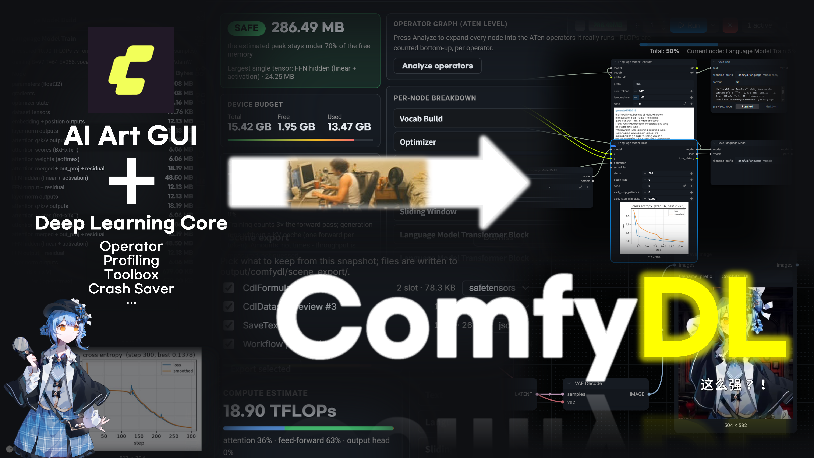

## What's This?

**Hardcore-overhauled by AI art software, this is a modular Deep Learning Toolbox GUI, API
and backend with a graph/nodes interface.**

`ComfyDL_UI` lets you build deep learning workflows — from CNNs to language models — by
connecting nodes in a graph, not by writing code. It hosts the
[ComfyDL](https://github.com/Cynthia-lxx/ComfyDL) node pack as a built-in set of nodes
(tensors, layers, optimizers, training loops, NLP pipelines, data utilities and
visualizations) on top of a trimmed ComfyUI runtime.

> It is **not** the complete original ComfyUI: this repository is a dehydrated fork
> (see [`docs/dehydrate_manifest.md`](docs/dehydrate_manifest.md)) that keeps the node-graph
> engine, server and basic image IO, and drops the diffusion-generation stack. If you want the
> original ComfyUI, get it from <https://github.com/comfyanonymous/ComfyUI>.

## What it looks like

A production-grade tabular regression workflow looks like:

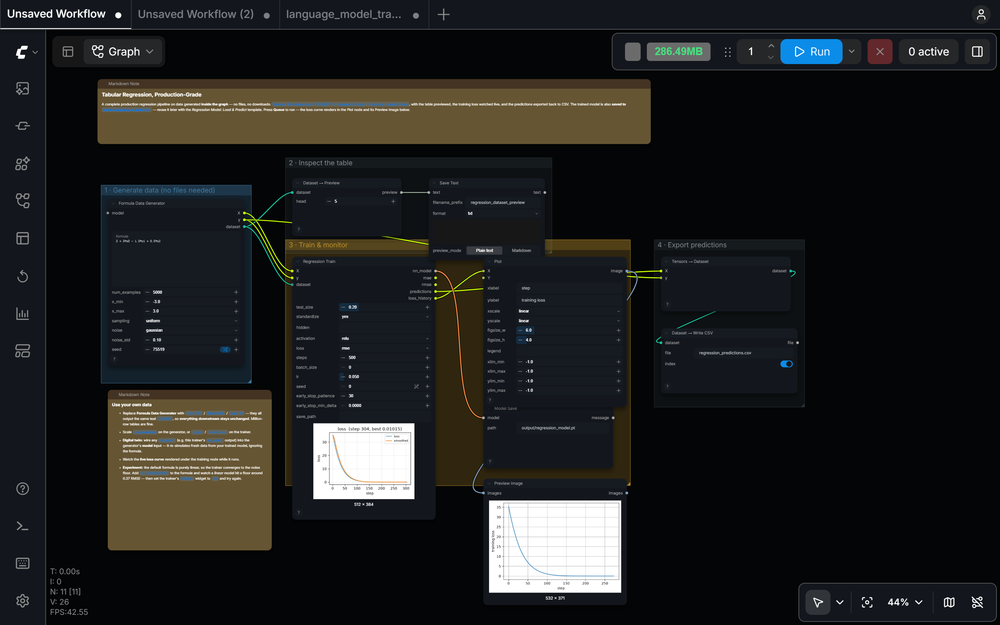

Language models tell the same story: 

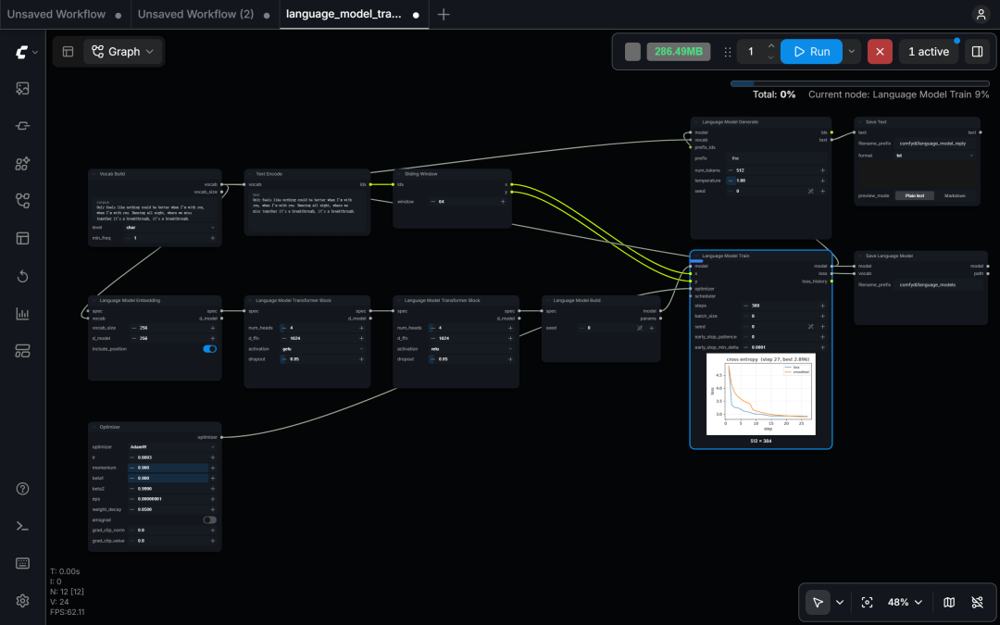

> More examples and the complete node reference live in the [`comfydl/`](comfydl/) submodule
> README ([中文](comfydl/README_zh.md), [FUNCTIONS.md](comfydl/FUNCTIONS.md)).

## Features

`ComfyDL_UI`'s headline capabilities each get their own section below — the visual editor, the
built-in node pack, live progress, full profiling, and the Crash Site save & resume net. The
everyday basics:

- Efficient local execution with asynchronous queueing and partial graph re-execution (only
  the parts of the graph that changed are re-run).
- Smart VRAM/RAM management with automatic CPU fallback when no GPU backend is available.
- Runs fully offline, downloads nothing unless you ask it to.
- Compatible with third-party custom nodes.
- Configure additional model locations with [`extra_model_paths.yaml`](extra_model_paths.yaml.example).

### Visual node-graph editor

Build deep-learning workflows by connecting nodes instead of writing code: drag, wire, group,
mute, bypass and collapse; re-run only the parts that changed; save and share the graph as
plain JSON (a generated PNG reloads the workflow — seeds included — that produced it).

### Most deep-learning operators, built in

You already know deep learning (don't you?) — here, most of it is a node away. Tensors and shape ops,
linear / conv / norm / attention layers, losses, optimizers with gradient clipping, LR
schedulers, training loops with early stopping, dataset readers and writers (CSV / Excel /
DB / JSON / TXT), tokenizers and language-model blocks, object detection, segmentation and
visualization — 128 nodes across 21 categories, wired instead of written.

The catalog at a glance:

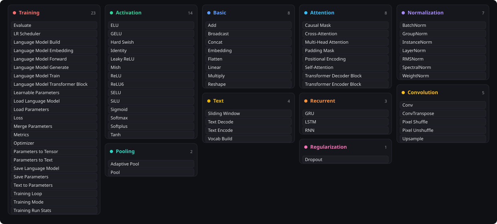

An **interactive version** — click any node for its description and source — ships at [`docs/network-and-layers.html`](docs/network-and-layers.html). View it rendered via [htmlpreview](https://htmlpreview.github.io/?https://github.com/Cynthia-lxx/ComfyDL_UI/blob/master/docs/network-and-layers.html) or open the file locally.

### Live progress & previews

Every long-running node reports per-step progress over the built-in WebSocket channel —
generated text appears under the language-model nodes as it is produced, and the top bar
tracks each run's cost while it executes.

### Profiling — memory, compute & operators

ComfyDL_UI profiles everything a graph costs, before and during the run. One panel holds the
whole story — the traffic-light memory verdict, the device budget, the compute estimate, the
per-node breakdown, the measured history and the ATen operator graph:

<p align="center">
  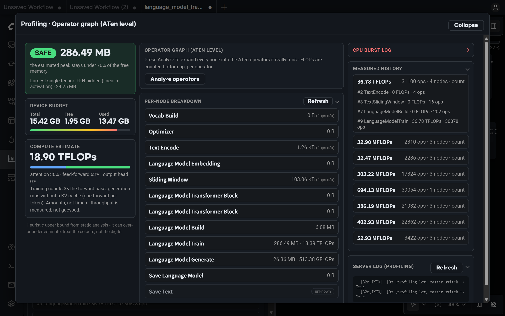
</p>

- **Memory** — peak estimation from parameters and data flow, graded green / amber / red
  against the device budget; red is **certain OOM** and warns before queueing. The breakdown
  goes down to tensor families — parameters, gradients, attention scores, FFN, logits — each
  with its byte count and largest single tensor, right next to the node it analyzes:

  <p align="center">
    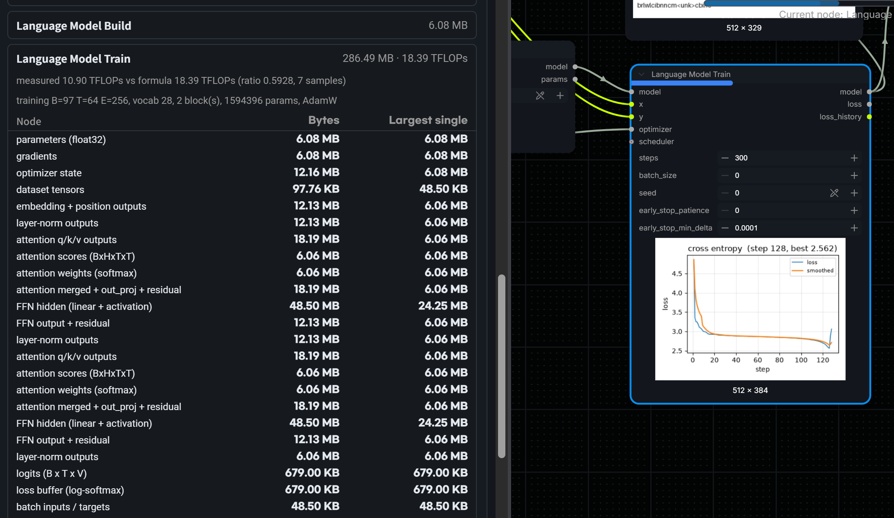
  </p>

  Pressing Run on a red graph warns with the numbers behind the verdict — and can be
  overridden:

  <p align="center">
    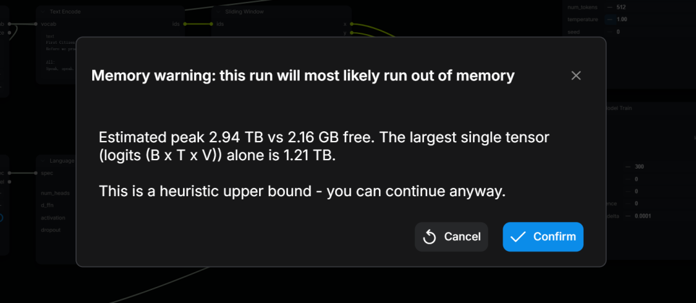
  </p>

- **Compute load** — a FLOPs ledger per node family (attention / FFN / logits / conv …) and
  per-node wall time, with a live top-bar indicator while the run executes.
- **Operator breakdown** — each node is expanded into the ATen operators it actually executes
  (`aten.mm`, `aten._softmax`, `aten.conv2d`, …); the op-level ledger cross-checks the formula
  estimates, and mismatches are flagged, not hidden.
- **Watchdog** — sampled CPU / RSS facts attributed to the executing node catch the nodes that
  monopolize the machine mid-run.
- **Honest about unknowns** — uncovered node types report `unknown`; failed probes fall back
  to formula values with an explicit `fallback` grade. Panels, badges and dialogs follow the
  UI language.

Design notes: [`docs/profiling-m1-memory-estimation.md`](docs/profiling-m1-memory-estimation.md),
[`docs/profiling-m2-compute-and-watchdog.md`](docs/profiling-m2-compute-and-watchdog.md),
[`docs/profiling-m3-estimator-families.md`](docs/profiling-m3-estimator-families.md),
[`docs/profiling-m3-opgraph.md`](docs/profiling-m3-opgraph.md).

### Crash Site — save & resume

A safety net for interrupted runs, with **zero overhead while everything works**:

- **Lazy capture** — nothing is written while the workflow runs at full speed; the moment it
  is interrupted or fails, surviving outputs are written to the snapshot library.
- **One-click resume** — re-queues the stored prompt and skips every finished node; the
  skip / re-run statistics appear on the new snapshot card when the run ends.
- **Scene export** — pick exactly what to keep, per node, with a format per row
  (safetensors / png / json / db / pt) plus the workflow prompt; files land in the output
  folder and surface in Results assets.
- **Breakpoint continuation** — the trainers (Regression Train, Training Loop, Language Model
  Train) save their complete state at the interrupt moment; a resume continues from the
  breakpoint step instead of starting a 10k-step training over.

The snapshot library in the sidebar — every run is filed with its captured nodes; interrupted
scenes offer Scene export:

<p align="center">
  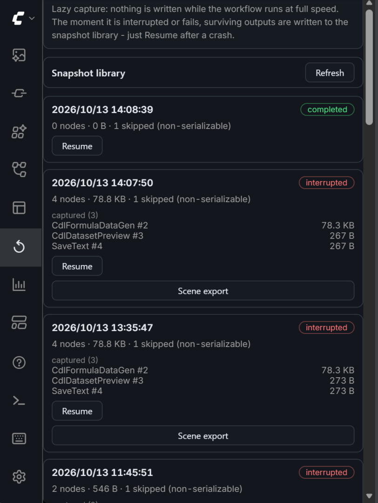
</p>

The scene-export table — choose what to keep and in which format:

<p align="center">
  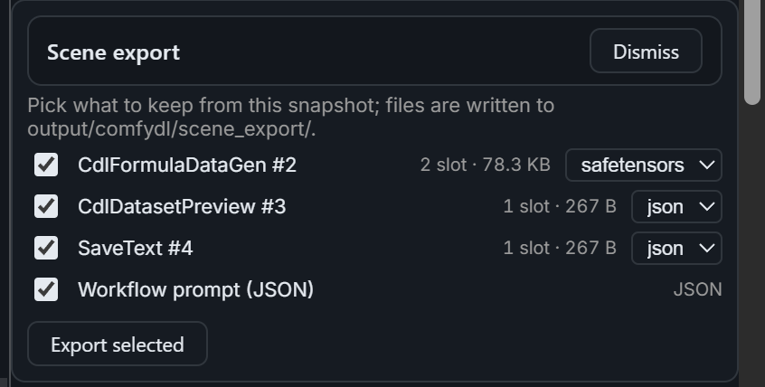
</p>

### Live loss map

Every trainer draws its loss map live on a card right under the node — the raw step loss and
the smoothed curve side by side, refreshed as the run progresses — so convergence or
divergence is visible at a glance, without opening anything:

<p align="center">
  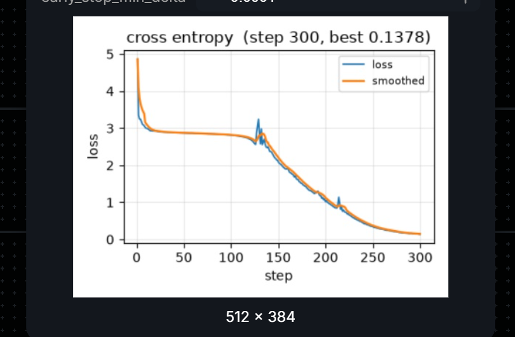
</p>

## Installation

Requires Python 3.12+ (3.13 recommended). Any OS with a supported PyTorch build works.

First create a virtual environment to keep the dependencies isolated — this avoids conflicts
with packages installed elsewhere on your machine:

```bash
git clone https://github.com/Cynthia-lxx/ComfyDL_UI
cd ComfyDL_UI
python -m venv .venv

.venv\Scripts\activate     # Windows
source .venv/bin/activate  # Linux / macOS
```

Then install the dependencies and launch:

```bash
pip install -r requirements.txt
python main.py
```

Open the address it prints. The ComfyDL nodes are already registered as built-ins — nothing
goes into `custom_nodes`.

### GPU acceleration

A CPU-only machine works out of the box. For GPU acceleration, install the PyTorch build that
matches your hardware into the same environment:

- **NVIDIA**: `pip install torch torchvision torchaudio --extra-index-url https://download.pytorch.org/whl/cu130`
- **AMD (Linux, ROCm)**: `pip install torch torchvision torchaudio --index-url https://download.pytorch.org/whl/rocm7.2`
- **Intel Arc**: `pip install torch torchvision torchaudio --index-url https://download.pytorch.org/whl/xpu`
- **Apple Silicon**: follow the [Accelerated PyTorch training on Mac](https://developer.apple.com/metal/pytorch/) guide.

If you get "Torch not compiled with CUDA enabled", `pip uninstall torch` and reinstall with the
matching command above.

## Running

```bash
python main.py
```

Useful flags (see `python main.py --help` for all of them):

- `--cpu` — force CPU execution.
- `--port 8188` — change the listening port.
- `--tls-keyfile key.pem --tls-certfile cert.pem` — serve over HTTPS instead of HTTP.

On AMD cards not officially covered by ROCm, try `HSA_OVERRIDE_GFX_VERSION=10.3.0 python main.py`
(RDNA2 and older) or `HSA_OVERRIDE_GFX_VERSION=11.0.0` (RDNA3).

### Notes

- Only parts of the graph whose outputs have all their inputs are executed, and re-submitting
  an unchanged graph re-runs only the parts that changed.
- Dragging a generated PNG onto the page loads the workflow (including seeds) that produced it.

## Keyboard shortcuts

| Keybind                            | Explanation                                                                                                        |
|------------------------------------|--------------------------------------------------------------------------------------------------------------------|
| `Ctrl` + `Enter`                      | Queue up current graph for generation                                                                              |
| `Ctrl` + `Shift` + `Enter`              | Queue up current graph as first for generation                                                                     |
| `Ctrl` + `Alt` + `Enter`                | Cancel current generation                                                                                          |
| `Ctrl` + `Z`/`Ctrl` + `Y`                 | Undo/Redo                                                                                                          |
| `Ctrl` + `S`                          | Save workflow                                                                                                      |
| `Ctrl` + `O`                          | Load workflow                                                                                                      |
| `Ctrl` + `A`                          | Select all nodes                                                                                                   |
| `Alt `+ `C`                           | Collapse/uncollapse selected nodes                                                                                 |
| `Ctrl` + `M`                          | Mute/unmute selected nodes                                                                                         |
| `Ctrl` + `B`                           | Bypass selected nodes (acts like the node was removed from the graph and the wires reconnected through)            |
| `Delete`/`Backspace`                   | Delete selected nodes                                                                                              |
| `Ctrl` + `Backspace`                   | Delete the current graph                                                                                           |
| `Space`                              | Move the canvas around when held and moving the cursor                                                             |
| `Ctrl`/`Shift` + `Click`                 | Add clicked node to selection                                                                                      |
| `Ctrl` + `C`/`Ctrl` + `V`                  | Copy and paste selected nodes (without maintaining connections to outputs of unselected nodes)                     |
| `Ctrl` + `C`/`Ctrl` + `Shift` + `V`          | Copy and paste selected nodes (maintaining connections from outputs of selected nodes to inputs of pasted nodes)   |
| `Shift` + `Drag`                       | Move multiple selected nodes at the same time                                                                      |
| `Ctrl` + `D`                           | Load default graph                                                                                                 |
| `Alt` + `+`                          | Canvas Zoom in                                                                                                     |
| `Alt` + `-`                          | Canvas Zoom out                                                                                                    |
| `Ctrl` + `Shift` + LMB + Vertical drag | Canvas Zoom in/out                                                                                                 |
| `P`                                  | Pin/Unpin selected nodes                                                                                           |
| `Ctrl` + `G`                           | Group selected nodes                                                                                               |
| `Q`                                 | Toggle visibility of the queue                                                                                     |
| `H`                                  | Toggle visibility of history                                                                                       |
| `R`                                  | Refresh graph                                                                                                      |
| `F`                                  | Show/Hide menu                                                                                                      |
| `.`                                  | Fit view to selection (Whole graph when nothing is selected)                                                        |
| Double-Click LMB                   | Open node quick search palette                                                                                     |
| `Shift` + Drag                       | Move multiple wires at once                                                                                        |
| `Ctrl` + `Alt` + LMB                   | Disconnect all wires from clicked slot                                                                             |

`Ctrl` can also be replaced with `Cmd` instead for macOS users.

## Documentation

- [`comfydl/`](comfydl/) — the node pack: `README.md` / `README_zh.md` and the complete node
  references `FUNCTIONS.md` / `FUNCTIONS_zh.md`.
- [`docs/`](docs/) — fork-specific notes: dehydration manifest, branding, built-in node pack,
  memory profiling, and the step-by-step reform design documents.
- [`AGENTS.md`](AGENTS.md) — how this repository is worked on.
- [中文说明](README_zh.md)

## Version and credits

- **Version** — `v0.3.1`, dehydrated from ComfyUI `v0.34.0`.
- **Maintainer** — [Cynthia-lxx](https://github.com/Cynthia-lxx).
- **License** — GPL-3.0, for this repository and the `comfydl/` submodule
  ([`LICENSE`](LICENSE), [`comfydl/LICENSE`](comfydl/LICENSE)).

This project is derived from [ComfyUI](https://github.com/comfyanonymous/ComfyUI) by
comfyanonymous and contributors. Upstream ComfyUI keeps its own copyright and maintainers; both
notices are listed at the end of [`LICENSE`](LICENSE). The upstream project's website, docs and
community live at <https://www.comfy.org/> and are maintained separately from ComfyDL_UI.

<p align="center">
  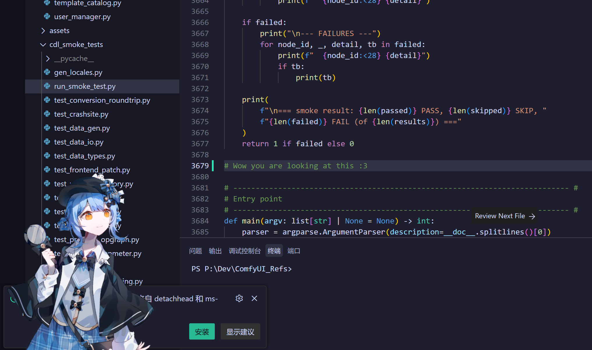
</p>
